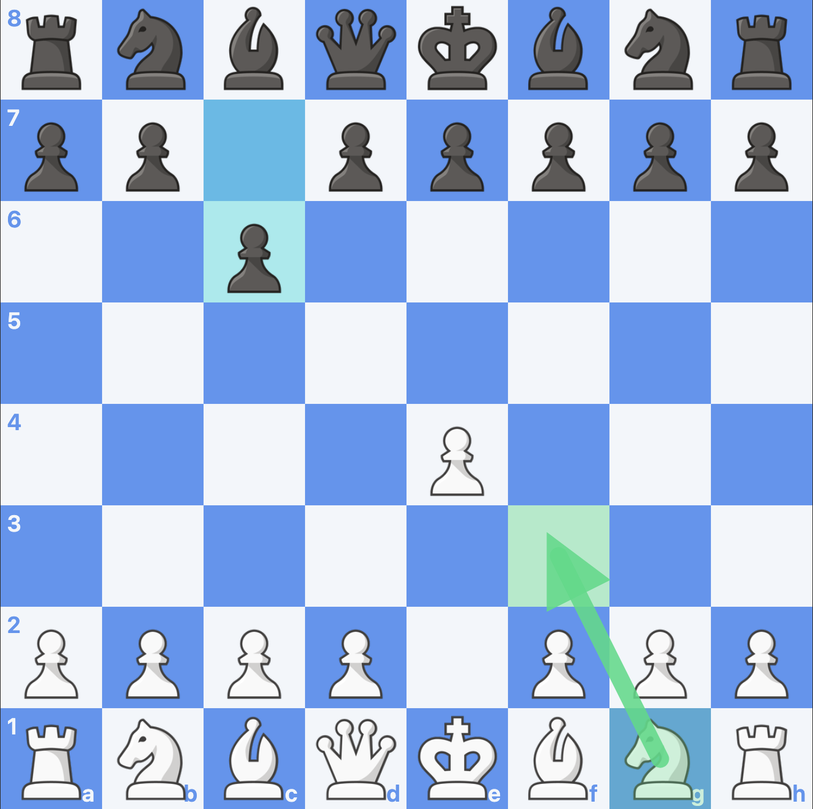
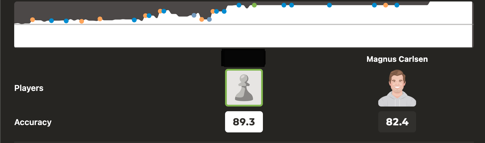

# chesscom-stockfish-overlay

Browser console scripts that run Stockfish 10 in a Blob Web Worker, poll `<wc-chess-board>` on Chess.com for position changes, and draw an SVG arrow over the best move.



Tested against the Magnus Carlsen bot on Chess.com, winning with 89.3% accuracy to 82.4%.



Use this only for local study, bot games, or post-game analysis. Running external engines in live rated games violates Chess.com's Fair Play Policy and will result in an account ban.

## Files

- `chesscom-stockfish-overlay.js`: Highlights the best move with an SVG arrow and square overlay.
- `chesscom-stockfish-automove.js`: Highlights the best move and executes it when you press `Enter` on your turn.

## Usage

1. Open a board page on Chess.com.
2. Open the browser DevTools console (`Cmd + Option + J` on macOS, `Ctrl + Shift + J` on Windows/Linux).
3. Copy the contents of either `chesscom-stockfish-overlay.js` or `chesscom-stockfish-automove.js`, paste into the console, and press Enter.
4. If using `chesscom-stockfish-automove.js`, press `Enter` once the green arrow appears on your turn to play the highlighted move.

To stop the polling loop, clean up listeners, terminate the worker, and clear the overlay:

```js
stopStockfish()

```

## Configuration

Edit the constants at the top of either script:

* `SEARCH_DEPTH` (default `14`): UCI search depth. Lower values return moves faster; higher values take longer.
* `POLL_MS` (default `800`): Interval in milliseconds between board state checks.
* `CDN_URL`: URL to a single-threaded `stockfish.js` build.

## How it works

* **Worker loading**: Browsers block `new Worker()` calls to cross-origin URLs, and Chess.com pages do not send `Cross-Origin-Embedder-Policy` headers required for `SharedArrayBuffer` builds. Both scripts fetch a single-threaded build of `stockfish.js` and load it from a same-origin `Blob` URL.
* **FEN extraction**: Reads `board.game.getFEN()` when exposed on `<wc-chess-board>`, or falls back to parsing `.piece` and `.square-XY` classes from the DOM.
* **Non-blocking overlay**: Appends a `position: fixed` SVG with `pointer-events: none` to `document.body` and aligns it to the board's `getBoundingClientRect()` coordinates. Appending inside `<wc-chess-board>` directly interferes with Chess.com's pointer handlers and blocks piece movement.
* **Move execution (`chesscom-stockfish-automove.js`)**: Pressing `Enter` calls `board.game.move()` when available or dispatches pointer events at the center coordinates of the source and target squares. Keypresses inside text inputs and chat boxes are ignored.

## License

MIT
